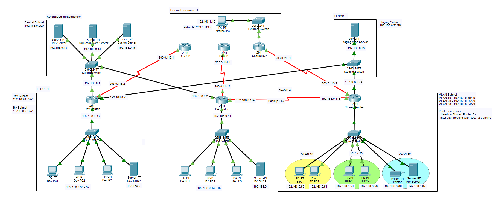

# cisco-enterprise-network-topology

# Multi-Floor Enterprise Network Topology & Security (Cisco Packet Tracer)

A collaborative network engineering project designing, segmenting, and securing a 3-floor corporate network infrastructure (`192.168.0.0/24`) for BrightSoft Solutions in Cisco Packet Tracer.

## Key Implementations
- **VLSM Subnetting & Services:** Segmented the `192.168.0.0/24` space across three floors and centralized infrastructure, deploying independent DHCP pools and an internal DNS server (`192.168.0.13`).
- **VLANs & Inter-VLAN Routing:** Configured VLAN 10 (Test Engineers), VLAN 20 (UI Designers), and VLAN 30 (Shared Resources) on Floor 2 using 802.1Q trunking and Router-on-a-Stick sub-interfaces.
- **Access Control & Static NAT (DMZ):** Published the Floor 3 Staging Web Server (`192.168.0.73`) to external partners over HTTP/HTTPS via Static NAT (`203.0.113.2`) while enforcing Extended ACLs to isolate internal teams and block unauthorized lateral traffic.
- **Dynamic Routing & Failover:** Configured OSPF Area 0 and RIPv2 with two-way route redistribution and verified automatic backup link failover using `tracert` and interface shutdown tests.

## How to Open
Open `BrightSoft Solutions Network Topology.pkt` in **Cisco Packet Tracer** (v8.2 or newer) to inspect router/switch running configs and test end-to-end connectivity.
